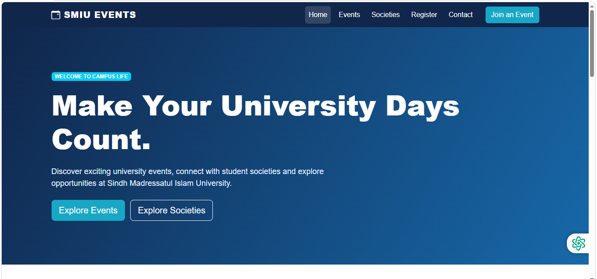
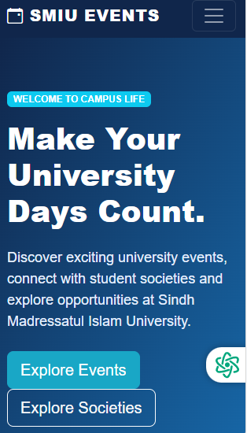

# SMIU Events Portal

## Project Description

The SMIU Events Portal is a responsive university event website
developed using HTML5, CSS3, Bootstrap 5.3.3 and JavaScript.

The purpose of this project is to provide students with a platform
where they can explore university events, discover student societies
and register their interest in different activities.

## Technologies Used

- HTML5
- CSS3
- Bootstrap 5.3.3
- Bootstrap Icons
- JavaScript
- Git and GitHub

## Project Pages

| Page | Description |
|---|---|
| index.html | Home page and featured events |
| events.html | Events listing and schedule |
| event-details.html | Event details and registration modal |
| societies.html | Student societies |
| register.html | Student registration form |
| contact.html | Contact information and team |

## Group Members

| Name            | Roll Number | 
| SHANZA BUKHARI  | BSE-24S-067 | 
| SONIA SEHAR     | BSE-24S-090 |
| MINHA AKBAR     | BSE-24S-018 | 

## How to Run

1. Clone or download the GitHub repository.
2. Open the project folder in Visual Studio Code.
3. Install the Live Server extension.
4. Open index.html.
5. Right-click and select Open with Live Server.
6. Navigate through the website using the navigation bar.

## Responsive Design

The website is designed to work on:

- Mobile: 360px
- Tablet: 768px
- Desktop: 1200px

Responsive testing was performed using Chrome Developer Tools.

## Teamwork and Merge Conflict

During development, multiple team members worked on the shared
CSS stylesheet. This resulted in a merge conflict when two
branches modified overlapping CSS rules.

We resolved the conflict by updating our feature branch with
the latest main branch, reviewing the conflicting code and
preserving both valid changes.

After resolving the conflict, we tested the affected pages,
committed the changes and continued with the Pull Request
review and merging process.

## Project Images

### Home Page - Desktop

### Home Page - Mobile

## Note

This is a front-end academic project. The registration and
contact forms demonstrate client-side validation and confirmation.
They do not save information to a database or send it to a server.
